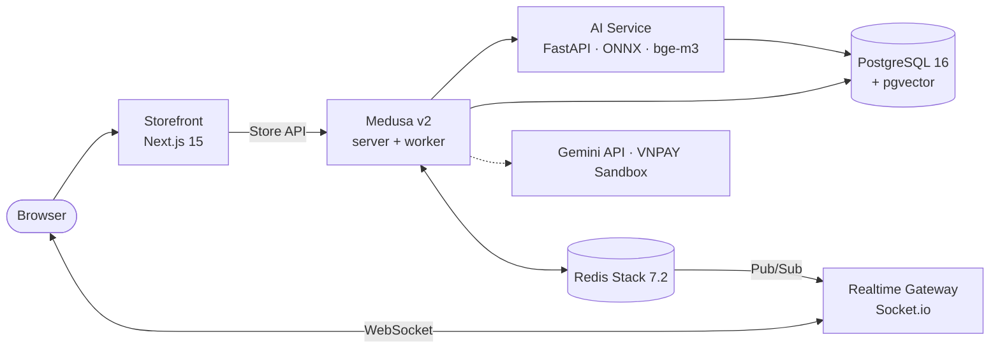

# Com4Fud — Real-Time Predictive Inventory Grocery Application

Đồ án môn **MSIS4133 – Công nghệ thông tin trong Thương mại điện tử** (Trường ĐH Công nghệ Thông tin, ĐHQG-HCM), Học kỳ 1 năm học 2026–2027.
Nhóm 05 · Hướng 1 (Advanced & Next-Gen E-Commerce Web Development) · Đề tài 5.

> Mở rộng nền tảng headless commerce **MedusaJS v2** với pre-warming giỏ hàng dự đoán trên RAM, kiểm soát tồn kho "nóng" nguyên tử bằng Redis, và trợ lý nấu ăn dựa trên RAG.

## Giới thiệu
 Com4Fud là một website bán hàng tạp hóa B2C theo mô hình **dark store** (một thương hiệu, nhiều kho giao hàng tại TP.HCM). Thay vì tự viết lại các phần thương mại cơ bản (catalog, giá, giỏ hàng, đơn hàng, tồn kho, xác thực, trang admin), nhóm dùng MedusaJS v2 và tập trung vào bốn tính năng khác biệt:

1. **Predictive Caching ("Buy It Again")**: mô hình LightGBM (chạy qua ONNX Runtime) dự đoán giỏ hàng mua lại của từng khách khi đăng nhập, rồi pre-warm vào Redis. Mục tiêu P95 < 10 ms.
2. **Atomic Hot-Stock Gate**: Redis Lua script giữ hàng tồn ít (hàng tươi sống) một cách nguyên tử trước khi thanh toán, bọc trong Medusa workflow có compensation. Mục tiêu không bán vượt tồn kho.
3. **Real-Time Stock Sync**: sự kiện tồn kho đi qua Redis Pub/Sub, được đẩy tới storefront qua WebSocket (Socket.io). Mục tiêu < 100 ms.
4. **Chef Copilot (RAG)**: tìm kiếm ngữ nghĩa công thức món Việt bằng `bge-m3` + pgvector, kết hợp Gemini tool calling để chuyển "món ăn" thành giỏ nguyên liệu còn hàng. Mục tiêu < 1,2 s.

Tất cả số liệu trên là **mục tiêu cần kiểm chứng** bằng benchmark Locust, chưa phải kết quả.

## Kiến trúc tổng quan

## Repositories

| Repository | Vai trò | Công nghệ chính |
| :--- | :--- | :--- |
| [grocery-store-frontend](https://github.com/Prosperum26/grocery-store-frontend) | Storefront cho khách hàng | Next.js 15 (Medusa Starter), Tailwind CSS, `@medusajs/js-sdk`, TanStack Query |
| [grocery-store-backend](https://github.com/Prosperum26/grocery-store-backend) | Commerce core và các custom module (`hot-stock`, `predictive`, `recipe`, `assistant`, `vnpay`) | MedusaJS v2, TypeScript, Redis Lua, PostgreSQL |
| [grocery-store-ai](https://github.com/Prosperum26/grocery-store-ai) | Microservice AI: `/predict`, `/embed`, `/search` | Python 3.11, FastAPI, LightGBM/ONNX, Polars, bge-m3, pgvector |

Code storefront đang được phát triển trên nhánh `dev` của repo này.
